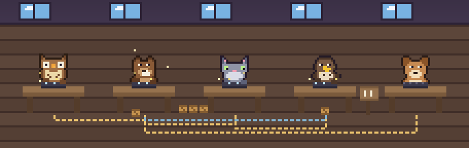
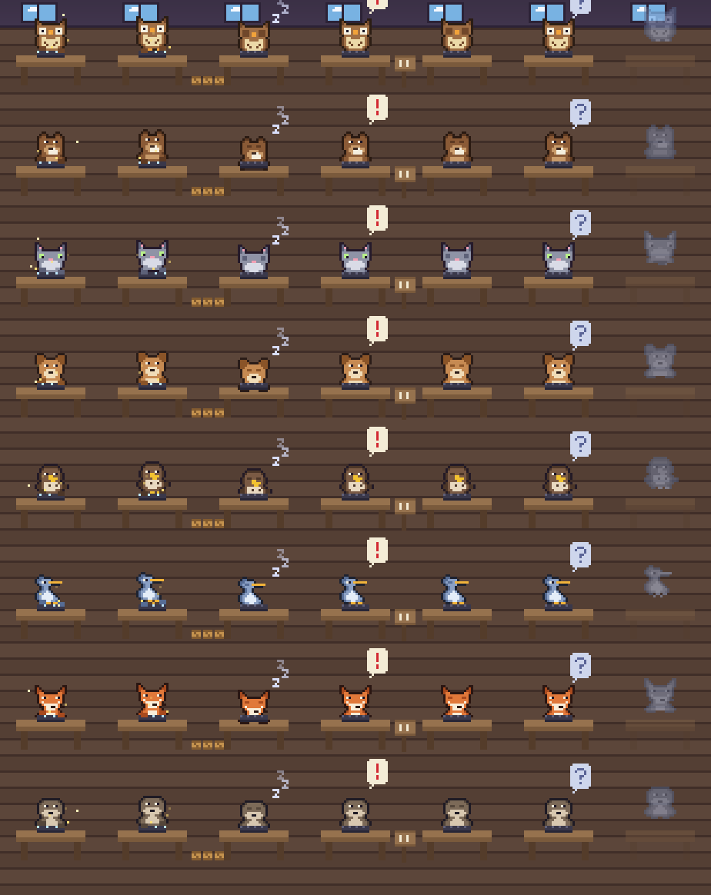

# rig-critters

Your [OpenRig](https://www.openrig.dev) agents as little pixel animals, working.

`critters` is a terminal UI (built with [Ratatui](https://ratatui.rs)) that draws one cozy workshop scene per rig. Every seat is an
animal at its own desk, and what the animal is doing is the seat's live state: typing and sparks while it works, curled up with a
"zzz" when idle, an "!" bubble when it needs you, a little sign when it is parked, a see-through ghost when it is not running, and a
stack of crates beside it for every queued item. Ropes between desks are the rig's edges, and a crate hops along one while the seat at
its end has work waiting.



*(This and every picture here come from `critters --demo`'s made-up seats, never from a real rig.)*

## Install and run

```
cargo install --git https://github.com/evanspn/rig-critters
critters --demo      # made-up seats, no rig needed
critters             # your rigs, live
```

It needs a terminal with truecolor. Graphics: **Ghostty, kitty and WezTerm** get crisp scalable pixels through the kitty graphics
protocol (the picture is sent with a fixed image id so each frame replaces the last in place, and sits *below* the text so seat names
stay readable). Anything else gets truecolor half-block characters. `--protocol auto|kitty|sixel|halfblocks` overrides the choice.
Inside **tmux** the graphics protocols need passthrough (`set -g allow-passthrough on`), so tmux gets half-blocks unless you force
`--protocol kitty`. Detection is by environment variables (`TERM_PROGRAM`, `TERM`, `GHOSTTY_RESOURCES_DIR`, ...), not by querying the
terminal. Sixel is implemented but only unit-tested.

| key | does |
| --- | --- |
| `Tab` / `Shift-Tab` | next / previous rig (or click a tab) |
| arrows, `h` `j` `k` `l` | select a seat (or click it); the side panel shows its details and neighbors |
| `+` / `-` | zoom the pixels |
| `p` | pause the animation |
| `?` | help and the legend |
| `q`, `Esc`, `Ctrl-C` | quit (the terminal, mouse and image are restored) |

Options: `--fps N` (default 12, max 30), `--zoom N`, `--no-tint` (the window and lighting follow your local time of day otherwise).

## What the animals mean

| you see | the seat is |
| --- | --- |
| typing at the keyboard, sparks | working |
| curled up, eyes closed, "zzz" | idle |
| "!" bubble | needs input or has failed |
| a little sign | parked / waiting |
| "?" bubble | state unknown |
| see-through ghost at a faded desk | not running |
| a stack of crates | queued work (the count is on the label) |
| glitter around it | active in the last few seconds |
| rope, with a crate hopping along it | a handoff to a seat that has work waiting |

## Which animal is which

By default the role names the animal: orchestrator and lead = owl, builder = beaver, QA = cat, security reviewer = dog,
PR watcher = hawk, monitor = heron, designer = fox, advisor and worker = otter. Any other role gets a stable pick from the eight by
a hash of its name, so a seat keeps its animal. Override in `~/.config/critters/animals.toml`:

```toml
[roles]            # the member name, exactly
builder = "otter"

[contains]         # a word anywhere in the member or pod name
watch = "fox"
```

The critters are `owl beaver cat dog hawk heron fox otter`. A bad entry is reported in the footer and ignored.



`critters sprites --out sheet.png` regenerates that sheet. The art is original, hand-made 16x16 pixel art kept as plain text in
[`assets/sprites.txt`](assets/sprites.txt) (palette lines and 16 rows of 16 characters per sprite), a format a web page could parse
too.

## What it reads (and nothing else)

Read-only, polled every ~1.5 s with fixed argv and no shell:

* `rig ps --nodes -A --json`: each seat's name, rig, runtime, lifecycle and activity state, counts of assigned and pending work, and its
  last-activity time.
* `rig spec show <rigId> --json` (cached for a minute): the edges between seats. The rig id is checked against a strict pattern before
  it reaches an argv.

Each seat is rebuilt **field by field from that allowlist**; whatever else the daemon sends (paths, tokens, titles) is dropped, names
are validated, counts are capped, and unknown states show as "?" rather than a guess. Queue rows, message bodies and transcripts are
never read. If `rig` is missing or its daemon is down you get a calm sleeping scene. `CRITTERS_RIG_BIN` names a different `rig` binary.

## Limits

* Screenshots here are generated from the demo fixture; the live view was checked in Ghostty 1.3.1 with the kitty protocol.
* Sixel and tmux passthrough are not verified on real terminals.
* Parked/blocked and "needs attention" depend on the activity strings the daemon reports; an unrecognised string shows "?".
* Sound and a web (canvas) view of the same sprites are not built.

## License

MIT, see [LICENSE](LICENSE).
